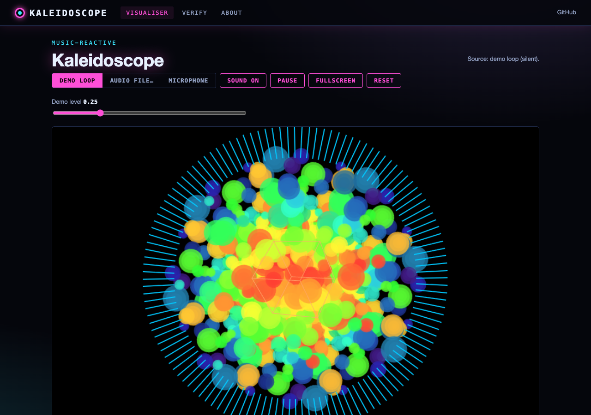
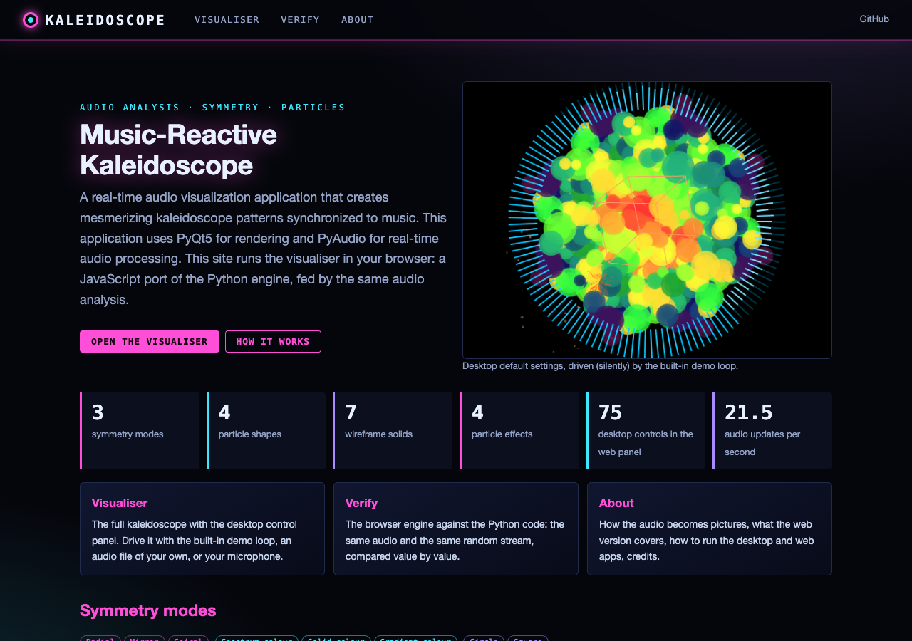
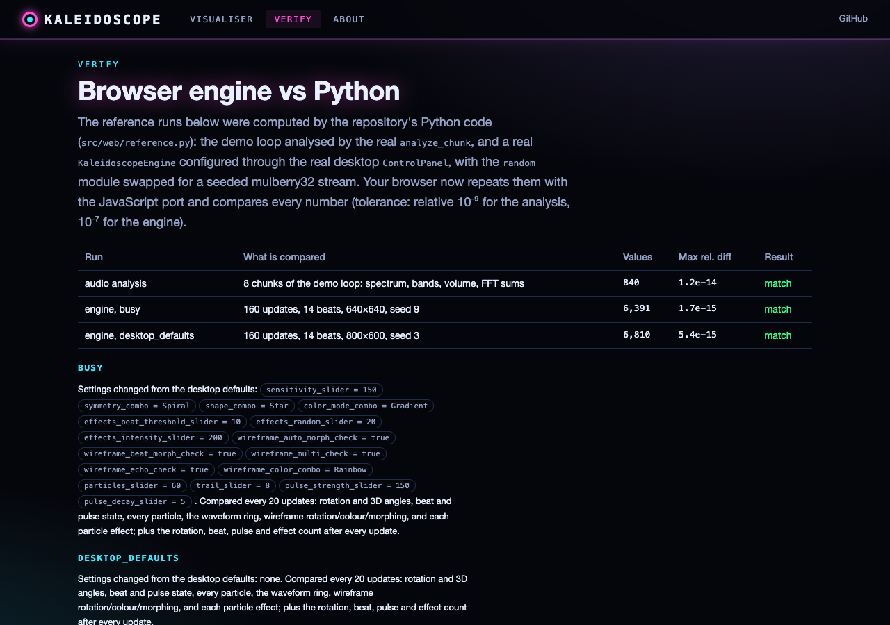

# Music-Reactive Kaleidoscope Visualizer

A real-time audio visualization application that creates mesmerizing kaleidoscope patterns synchronized to music. This application uses PyQt5 for rendering and PyAudio for real-time audio processing.



## Features

- **Real-time Audio Analysis**: Captures and analyzes audio from your microphone in real-time
- **Particle-based Visualizations**: Dynamic particle system creates flowing patterns
- **Multiple Symmetry Modes**: Choose from radial, mirror, and spiral symmetry options
- **3D Effects**: Enable perspective and depth for immersive visuals
- **Beat Detection**: Pulse effects that react to bass beats
- **Customizable Colors**: Multiple color modes including spectrum, solid, and gradient
- **Wireframe Cube Overlay**: 3D wireframe cube that rotates with the music
- **Post-processing Effects**: Apply blur and distortion for enhanced visuals
- **Multi-monitor Support**: Run in fullscreen mode on any connected display
- **Frequency Spectrum Display**: View the audio frequency spectrum in real-time
- **Comprehensive Controls**: Extensive UI for customizing all aspects of the visualization

## Requirements

- Python 3.7+
- PyQt5
- PyAudio
- NumPy

## Installation

1. Clone the repository:
   ```
   git clone https://github.com/gddickinson/kaleidoscope.git
   cd kaleidoscope
   ```

2. Create and activate a virtual environment (optional but recommended):
   ```
   python -m venv venv
   source venv/bin/activate  # On Windows: venv\Scripts\activate
   ```

3. Install the dependencies:
   ```
   pip install -r requirements.txt
   ```

## Usage

Run the application:
```
python main.py
```

### Controls

The application features a tabbed interface with multiple control panels:

#### Visual Controls
- General settings (segments, rotation, symmetry)
- Visual effects (colors, shapes, blur, distortion)
- Display settings (FPS, fullscreen mode)

#### Technical Controls
- 3D effects (enable 3D, depth influence, perspective)
- Pulse system (strength, attack, decay)
- Audio settings (sensitivity, smoothing, frequency influence)

#### Effect Visualizations
- Wireframe cube (size, rotation, color settings)

### Keyboard Shortcuts

The desktop app has no keyboard shortcuts: use the Fullscreen check box (Visual Controls, Display Settings) to
enter and leave fullscreen. (Earlier versions of this README listed F, Esc, R and Space; the code never
implemented them. The web version below does offer them.)

## Project Structure

```
.
├── main.py                 # Application entry point
├── src/
│   ├── __init__.py
│   ├── app/
│   │   ├── __init__.py
│   │   └── main_window.py  # Main application window
│   ├── core/
│   │   ├── __init__.py
│   │   ├── audio_processing.py            # Audio processing and analysis
│   │   ├── kaleidoscope_engine.py         # Core visualization engine
│   │   └── visualization_components.py     # Particles and rendering components
│   ├── plugins/
│   │   ├── __init__.py
│   │   └── plugins.py      # Effect, shape, and color plugins
│   └── ui/
│       ├── __init__.py
│       ├── control_panel.py               # UI controls for visualization
│       ├── debug_console.py               # Debugging tools
│       └── widgets.py                     # Visualization display widgets
└── requirements.txt        # Project dependencies
```

## Web version

The visualiser also runs in the browser: **https://gddickinson.github.io/kaleidoscope/** (published from `main` by
GitHub Pages). It is a JavaScript port of the engine (particles, symmetry, waveform ring, wireframes, particle effects)
and of the audio analysis, with the desktop control panel's controls and defaults read from the real `ControlPanel`.
Drive it with the built-in demo loop, an audio file of your own, or the microphone (only after you click it).
The Verify page replays seeded runs of the Python engine in the browser and compares every value.
Not ported: the particle tunnel and the experimental effects (all off by default on the desktop).

| Home | Visualiser | Verify |
|---|---|---|
|  |  |  |

### Run the web app

```
pip install -r requirements-web.txt
python run_web.py            # http://127.0.0.1:8224
```

The local app adds one thing the static site cannot do: on the Verify page, your own audio is analysed by the
Python `analyze_chunk` as well as in JS. Developer commands:

```
python -m pytest -q tests/                   # all tests (node tests run if node is installed)
python scripts/make_fixtures.py              # regenerate Python reference data (needs PyQt5)
python scripts/build_static.py --out site    # build the static site
python scripts/screenshots.py --static "" visualiser verify about   # browser smoke test (Playwright)
```

## Performance Tips

1. If you experience low performance:
   - Reduce the number of particles
   - Disable blur and 3D effects
   - Lower the FPS setting

2. For higher quality visuals on powerful systems:
   - Increase particle count
   - Enable all effects
   - Set FPS to 60 or higher

## Troubleshooting

### Audio Input Issues

If no audio is detected:
- Check your default microphone settings
- Ensure your system allows microphone access
- Try increasing the sensitivity in the Audio Controls panel

### Performance Issues

If the visualization is laggy:
- Reduce the number of particles (Visual Effects panel)
- Disable blur and distortion effects
- Disable 3D effects and wireframe visualizations

## Extending the Application

The application is designed with modularity in mind, making it easy to add new:
- Visual effects
- Symmetry modes
- Particle shapes
- Color generators

Refer to the plugin architecture in `src/plugins/plugins.py` for examples.

## License

This project is licensed under the MIT License - see the LICENSE file for details.

## Acknowledgments

- FFT algorithm implementation based on the NumPy library
- Audio processing inspired by various music visualization projects
- Special thanks to all contributors and testers

---

Developed with ♪♫ by George and Claude AI
